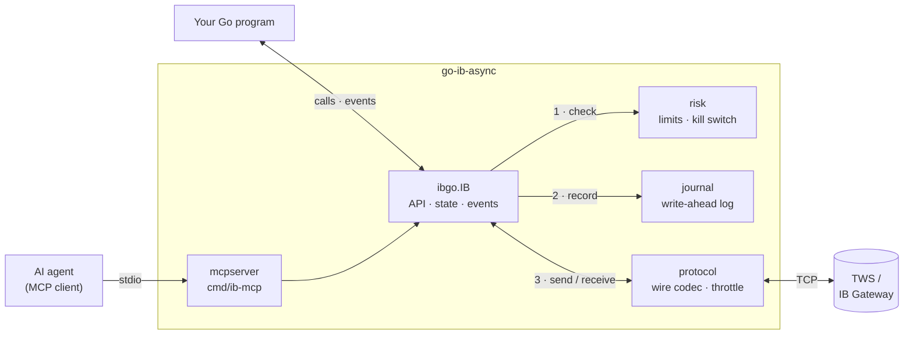

# go-ib-async

[](https://github.com/kevinzhao-dev/go-ib-async/actions/workflows/ci.yml)
[](https://pkg.go.dev/github.com/kevinzhao-dev/go-ib-async)
[](LICENSE)

A Go client for the Interactive Brokers TWS / IB Gateway API, ported from
Python's [ib_async](https://github.com/ib-api-reloaded/ib_async), with guard
rails for code (and AI agents) that trade.

- **Live objects.** Tickers, bars and trades update in place and fire events,
  like ib_async. `Snapshot()` gives a race-free copy from any goroutine.
- **Survives disconnects.** Auto-reconnect keeps orders, fills and positions
  and re-subscribes every stream: the objects you hold keep updating.
- **Guard rails built in.** Pre-trade risk limits with a kill switch, a
  write-ahead order journal with crash recovery, and an order-blocking proxy
  for testing against live accounts.
- **AI agents via MCP.** `ib-mcp` gives Claude (or any MCP client) market
  data, account data and, if you allow it, risk-checked paper trading.
- **Zero dependencies.** Standard library only. Verified against a live
  Gateway, race-tested, fuzzed, 95% coverage.

## Quick start

```bash
go get github.com/kevinzhao-dev/go-ib-async
```

```go
func main() {
    ctx := context.Background()
    ib := ibgo.New()
    if err := ib.Connect(ctx, "127.0.0.1", 4002, 1); err != nil { // IB Gateway (paper)
        log.Fatal(err)
    }
    defer ib.Disconnect()

    aapl := contract.Stock("AAPL", "SMART", "USD")
    if err := ib.QualifyContracts(ctx, aapl); err != nil {
        log.Fatal(err) // errors.Is(err, ibgo.ErrContractNotFound), ...
    }

    // Live objects: the Ticker updates in place and fires an event per update.
    ib.ReqMarketDataType(ibgo.MarketDataDelayed) // works without a data subscription
    ticker, err := ib.ReqMktData(aapl, "", false, false)
    if err != nil {
        log.Fatal(err)
    }
    ticker.UpdateEvent.Subscribe(func(t *market.Ticker) {
        fmt.Printf("AAPL bid %.2f ask %.2f\n", t.Bid, t.Ask)
    })

    // Guard rails: every order passes the risk manager before it is sent.
    ib.SetRiskManager(risk.New(risk.Limits{MaxOrderQuantity: 100, MaxDailyLoss: 1000}, ib))
    _, err = ib.PlaceOrder(aapl, order.LimitOrder("BUY", 1000, 150))
    fmt.Println(err) // risk: order_quantity: quantity 1000 exceeds max 100 (nothing sent)

    time.Sleep(10 * time.Second)
}
```

The [guide](docs/GUIDE.md) covers streaming data, bars, orders and brackets,
the order journal, and reconnecting.

## AI agents (MCP)

`ib-mcp` is a [Model Context Protocol](https://modelcontextprotocol.io)
server that runs next to TWS / IB Gateway:

```bash
go install github.com/kevinzhao-dev/go-ib-async/cmd/ib-mcp@latest
claude mcp add ib -- ib-mcp -port 4002
```

Then ask things like *"What's my buying power?"*, *"Show SPY's daily bars
for the last month"* or *"What would buying 10 MSFT at 410 do to my
margin?"*. The agent can look up contracts, quotes, bars and option chains,
read positions, balances, orders and fills, and preview orders.

It is **read-only by default**. With `-enable-trading` it trades paper
accounts only, behind risk limits and a journal, and an order is sent only
from a single-use preview, so what reaches IB is exactly what you approved.
Agents can halt trading but never resume it. See [docs/MCP.md](docs/MCP.md)
for the tools, the safety model and Claude Desktop setup.

## Architecture



An order is checked against the risk limits and recorded in the journal
before it is sent; order placement is serialised, so concurrent orders cannot
race past the limits. One reader goroutine decodes every inbound message,
updates state and runs event callbacks, so keep callbacks short. Data types
live in `contract`, `order`, `market` and `account`. More in the
[concurrency model](docs/GUIDE.md#concurrency-model).

## Status

- **Verified against a live IB Gateway** (server version 178): connection
  and reconnect, contracts, historical data, streaming market data (incl.
  greeks, tick-by-tick, depth), positions, account values and PnL.
- **Tested end to end against a fake gateway**: placing, modifying and
  cancelling orders, brackets, what-if, risk manager, journal, MCP server.
  Run the [paper trading test](docs/LIVE_TESTING.md#paper-trading-test)
  before trading live.
- **Not yet implemented**: scanners, news, fundamental data, histograms, FA
  and WSH.

Full feature matrix and change log: [STATUS.md](STATUS.md).

## Documentation

- [Guide](docs/GUIDE.md): market data, orders, risk and journal, reconnect, concurrency
- [MCP server](docs/MCP.md): tools, safety model, configuration, embedding
- [Live testing](docs/LIVE_TESTING.md): `ibguard` proxy, smoke test, market data check, paper trading test
- [Development](docs/DEVELOPMENT.md): make targets, test suite, CI
- [Status](STATUS.md): parity with ib_async, verified features, known gaps

Requires Go 1.24+. BSD 2-Clause, see [LICENSE](LICENSE).
