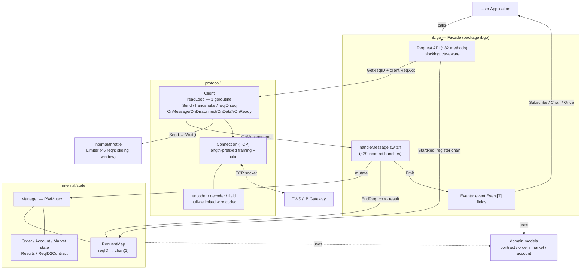
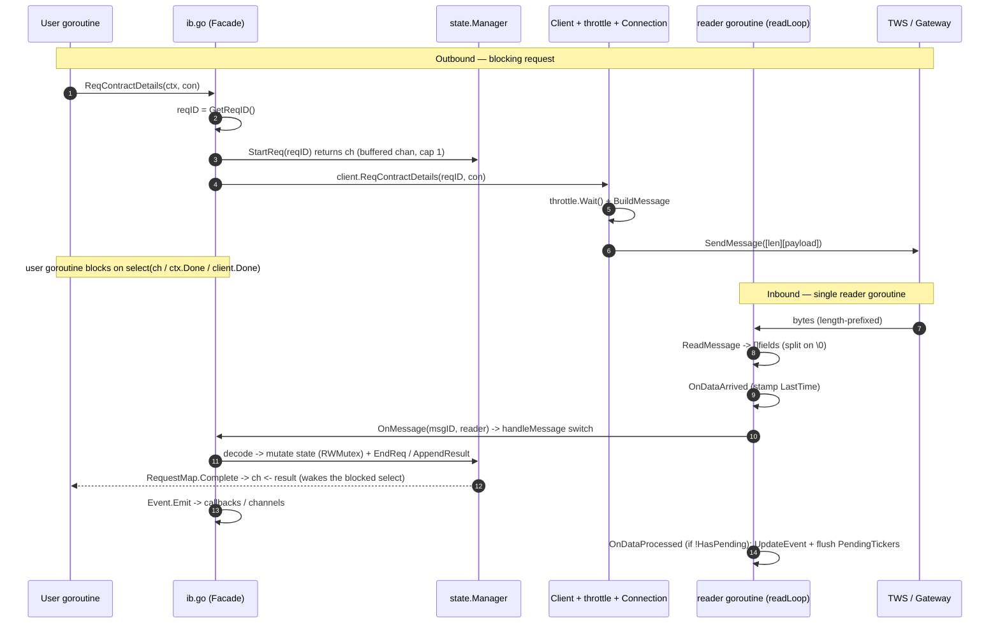
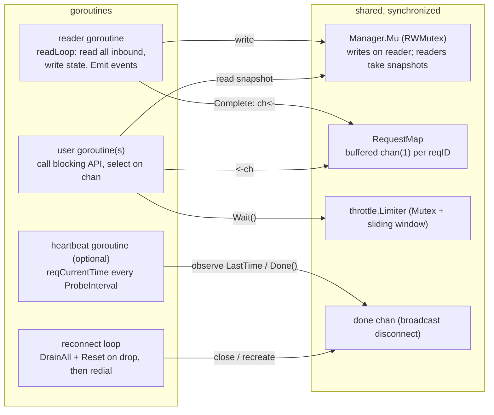

# Architecture

`go-ib-async` is a Go port of the Python [ib_async](https://github.com/ib-api-reloaded/ib_async)
client for the Interactive Brokers TWS/Gateway API. Instead of wrapping the
official IB SDK, it speaks the TWS **wire protocol** directly over TCP
(length-prefixed frames, null-delimited fields).

The design is cleanly layered, with a single facade (`ib.go`) coordinating two
independent subsystems: the `protocol` stack (transport) and `internal/state`
(domain state + request/response matching). The diagrams below render natively
on GitHub. Static PNG copies of all three diagrams live in
[`docs/img/`](img/) for viewers that don't render Mermaid.

> This document describes the current code. Where it disagrees with a summary
> elsewhere (e.g. an older "Known Limitations" list), the code is the source of
> truth: auto-reconnect/heartbeat (`reconnect.go`) and request throttling
> (`internal/throttle`) are implemented and wired in.

---

## 1. Component model (who owns whom)

The pivot of the design: **`Client` does not depend on `state`.** Both are
`internal`/transport concerns held by the `ib.go` facade, which alone wires them
together — registering a response channel on the way out, and feeding the
decoded message into state on the way in.

---

## 2. Request / response data flow

Two flows meet at a single point — the per-request buffered channel in
`RequestMap`. The outbound goroutine waits on `<-ch`; the inbound reader
goroutine pushes the result back with `ch <- result`.

- **Buffered `chan(1)` is deliberate:** `Complete` never blocks the reader
  goroutine even if the waiting consumer is slow or already gone.
- **Cancellation & disconnect are first-class:** the outbound `select` also
  watches `ctx.Done()` (→ `RequestMap.Cancel`) and `client.Done()` (→
  `ErrDisconnected`), so a request never leaks.
- **Multi-message responses** (e.g. `contractDetails` … `contractDetailsEnd`)
  accumulate via `AppendResult`, and only the terminal `*End` message calls
  `EndReq` to deliver the slice.

---

## 3. Concurrency model

The core invariant: **one reader goroutine owns all inbound processing and state
writes; user goroutines only read snapshots** (guarded by `RWMutex`) and receive
results over channels. This keeps the hot inbound path lock-light and avoids
fan-in races.

---

## 4. Layer reference

| Layer | Package | Responsibility | Key types |
|-------|---------|----------------|-----------|
| Facade | `ib.go` (`ibgo`) | Public blocking API, inbound dispatch (`handleMessage`), event surface | `IB`, `IBError` |
| Transport — client | `protocol/client.go` | Handshake/`startApi`, `readLoop`, outbound request builders, reqID sequence, lifecycle hooks | `Client`, `ClientState` |
| Transport — conn | `protocol/connection.go` | TCP dial, length-prefixed framing, batch detection (`HasPending`) | `Connection` |
| Transport — codec | `protocol/{encoder,decoder,field,message}.go` | Field encode/decode, message IDs, `FieldReader`, `BuildMessage` | `FieldReader` |
| State | `internal/state/` | Domain state + request/response matching, all mutated on the reader goroutine | `Manager`, `RequestMap`, `Result` |
| Throttle | `internal/throttle/` | Sliding-window rate limit applied in `client.Send` | `Limiter` |
| Events | `event/` | Generic typed pub/sub (callback + channel) | `Event[T]` |
| Domain | `contract/`, `order/`, `market/`, `account/` | Plain data types (contracts, orders/trades, tickers/bars, positions/PnL) | `Contract`, `Trade`, `Ticker`, `Position` |
| Resilience | `reconnect.go` | Auto-reconnect loop + heartbeat probe | `ReconnectConfig` |

---

## 5. Design notes

These are behaviors that the boxes-and-arrows don't make obvious:

- **Batch semantics.** `Connection.HasPending()` checks whether the `bufio.Reader`
  still holds buffered bytes, grouping all IB messages that arrived in one TCP
  read into a "batch". `OnDataArrived` fires once at the start (stamping
  `LastTime`); `OnDataProcessed` fires once at the end, emitting `UpdateEvent`
  and flushing accumulated `PendingTickers` in a single sweep — matching the
  Python library's pending-ticker semantics.

- **Handshake is inlined in `readLoop`.** The first frame (`version, connTime`)
  and the subsequent `nextValidId` (9) / `managedAccounts` (15) messages are
  snooped directly inside the read loop. Only once both have arrived does
  `OnReady` fire, unblocking the caller of `Connect()`.

- **Subscription-style requests are serialized.** `ReqPositions` /
  `ReqCompletedOrders` get a single shared `*End` from IB regardless of how many
  callers are waiting. They use a dedicated mutex plus a synthetic negative
  reqID (`syntheticReqID`) so concurrent callers don't steal each other's End.

- **Event emission is non-blocking for channels.** `Event[T].Emit` invokes
  callbacks synchronously, then performs non-blocking sends to channel
  subscribers (dropping if the buffer is full) so a slow subscriber can't stall
  the reader goroutine.

- **Reconnect resets cleanly.** On a dropped connection the reconnect loop drains
  all pending requests with `ErrDisconnected` and calls `state.Reset()` before
  redialing, so stale per-request channels and domain state never bleed across
  connections. An optional heartbeat sends `reqCurrentTime` every
  `ProbeInterval` and forces a disconnect if no traffic is observed within
  `ProbeTimeout`.
